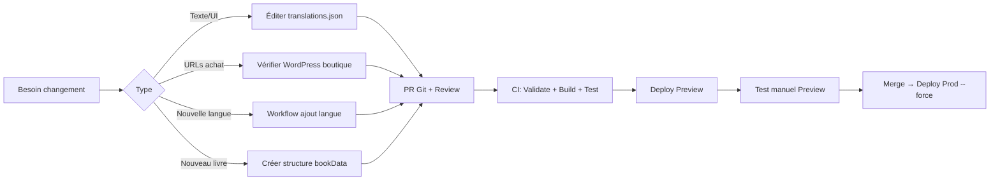

# Skill: kikienchrist-data-pipeline

## Vue d'Ensemble

```
Source de Vérité          Build & Validation          Déploiement          Sync Externe
┌─────────────────┐      ┌──────────────────┐       ┌─────────────┐      ┌──────────────┐
│ translations.json │────▶│ Astro Build      │──────▶│ Vercel      │─────▶│ Lulu / Payhip│
│ (Git)             │      │ + Validation     │       │ (Edge + CDN)│      │ Google Play  │
└─────────────────┘      └──────────────────┘       └─────────────┘      └──────────────┘
        │                        │                        │                   │
        ▼                        ▼                        ▼                   ▼
   Git History              TypeScript +           Preview/Prod           Webhook/API
   + Branches               Zod Schema             URLs                   (futur)
        │                        │                        │                   │
        ▼                        ▼                        ▼                   ▼
   Backup Auto            Lighthouse CI           Analytics             Dashboard
   (GitHub)               + Tests                  (GA4/Vercel)          Ventes
```

---

## 1. Source de Vérité : `translations.json`

### Structure Critique (Rappel)
```json
{
  "fr": { "hero": {}, "books": {}, "bandeau": {}, "newsletter": {}, "faq": {}, "footer": {}, "cta": {}, "bookData": {} },
  "en": { ... }, "es": { ... }, "de": { ... }, "pt": { ... }, "it": { ... }, "ru": { ... }, "zh": { ... }, "hi": { ... }
}
```

### Validation Schema (Zod) — `src/utils/translations-schema.ts`
```typescript
import { z } from 'zod';

export const BookOfferSchema = z.object({
  price: z.string().regex(/^\d+(\.\d{1,2})?$/),
  priceCurrency: z.enum(['EUR', 'USD']),
  url: z.string().url(),
  seller: z.object({ name: z.enum(['Lulu', 'Payhip', 'Google Play']) }),
  availability: z.literal('https://schema.org/InStock'),
});

export const BookLanguageSchema = z.object({
  code: z.string().length(2),
  name: z.string(),
  fmt: z.string(),
});

export const BookDataSchema = z.object({
  name: z.string().min(1),
  description: z.string().min(10),
  coverImage: z.string().url(),
  offers: z.array(BookOfferSchema).min(1).max(3),
  languagesLabel: z.string(),
  languages: z.array(BookLanguageSchema).min(1),
});

export const TranslationsSchema = z.object({
  fr: z.object({
    hero: z.object({ eyebrow: z.string(), title: z.string(), subtitle: z.string(), ctaPrimary: z.string(), ctaGhost: z.string() }),
    books: z.object({ seriesPrefix: z.string(), hook: z.string(), benefits: z.array(z.string()).length(3), metaSuffix: z.string(), languagesLabel: z.string(), languages: z.array(BookLanguageSchema) }),
    bandeau: z.object({ paper: z.string(), ebook: z.string(), audio: z.string() }),
    newsletter: z.object({ title: z.string(), description: z.string(), placeholder: z.string(), buttonText: z.string(), tinyText: z.string() }),
    faq: z.object({ title: z.string(), items: z.array(z.object({ q: z.string(), a: z.string() })).min(3) }),
    footer: z.object({ nav: z.array(z.string()), rights: z.string(), madeWith: z.string(), languageSwitcher: z.object({ label: z.string(), ariaLabel: z.string() }) }),
    cta: z.object({ text: z.string(), buttonText: z.string(), buttonHref: z.string() }),
    bookData: z.record(BookDataSchema),
  }),
  // ... autres langues (même structure)
});

// Validation au build
export function validateTranslations(data: unknown) {
  return TranslationsSchema.parse(data);
}
```

### Intégration Build (`astro.config.mjs` ou script pre-build)
```javascript
// scripts/validate-translations.js
import { readFileSync } from 'fs';
import { validateTranslations } from '../src/utils/translations-schema.js';

const data = JSON.parse(readFileSync('./src/data/translations.json', 'utf-8'));
validateTranslations(data);
console.log('✅ translations.json valide');
```
```json
// package.json
"scripts": {
  "validate:translations": "node scripts/validate-translations.js",
  "build": "npm run validate:translations && astro build"
}
```

---

## 2. Pipeline Build & Validation

### Étapes Build (Ordre)
```bash
# 1. Validation données
npm run validate:translations

# 2. TypeScript check
npm run check

# 3. Lint
npm run lint

# 4. Tests unitaires
npm run test

# 5. Build Astro (génère dist/)
npm run build

# 6. Validation build output
npm run validate:build
```

### Validation Build Output (`scripts/validate-build.js`)
```javascript
import { readFileSync, readdirSync } from 'fs';
import { join } from 'path';

const dist = './dist';
const langs = ['fr', 'en', 'es', 'de', 'pt', 'it', 'ru', 'zh', 'hi'];

console.log('🔍 Validation build output...');

// 1. Vérifier 9 langues + racine
const pages = readdirSync(dist).filter(f => f.endsWith('.html'));
console.log(`Pages HTML: ${pages.length} (attendu ≥ 10)`);

// 2. Vérifier chaque langue a index.html
langs.forEach(lang => {
  const path = join(dist, lang, 'index.html');
  if (!existsSync(path)) throw new Error(`Manquant: ${lang}/index.html`);
  const html = readFileSync(path, 'utf-8');
  
  // Vérifications critiques
  const checks = [
    { name: 'hreflang', regex: /rel="alternate".*hreflang/ },
    { name: 'canonical', regex: /rel="canonical"/ },
    { name: 'JSON-LD Book', regex: /"@type":\s*"Book"/ },
    { name: 'JSON-LD FAQ', regex: /"@type":\s*"FAQPage"/ },
    { name: 'lang attribute', regex: new RegExp(`lang="${lang}"`) },
    { name: 'BookCard x4', regex: /class="book"/g }, // 4 occurrences
  ];
  
  checks.forEach(c => {
    const matches = html.match(c.regex);
    if (!matches) throw new Error(`${lang}: ${c.name} manquant`);
    if (c.name === 'BookCard x4' && matches.length !== 4) {
      throw new Error(`${lang}: 4 BookCard attendues, trouvé ${matches.length}`);
    }
  });
  console.log(`✅ ${lang}/index.html valide`);
});

// 3. CSS unique + minifié
const cssFiles = readdirSync(join(dist, 'styles')).filter(f => f.endsWith('.css'));
if (cssFiles.length !== 1) throw new Error(`CSS files: ${cssFiles.length} (attendu 1)`);
const css = readFileSync(join(dist, 'styles', cssFiles[0]), 'utf-8');
if (css.length > 100000) console.warn('⚠️ CSS > 100KB');
console.log('✅ CSS OK');

// 4. Sitemap
const sitemap = readFileSync(join(dist, 'sitemap.xml'), 'utf-8');
if (!sitemap.includes('<url>')) throw new Error('Sitemap vide');
console.log('✅ Sitemap OK');

console.log('🎉 Build validation passed!');
```

---

## 3. Déploiement & Sync

### Vercel Deploy (Actuel)
```bash
# Production (force cache bust)
npm run build && vercel --prod --force

# Preview (auto sur push Git)
vercel
```

### Variables d'Environnement Vercel (Sync Config)
| Variable | Scope | Description |
|----------|-------|-------------|
| `PUBLIC_SITE_URL` | Build + Runtime | URL canonique pour sitemap/canonical/GA4 |
| `PUBLIC_GA_ID` | Build + Runtime | GA4 Measurement ID |
| `SENTRY_DSN` | Runtime (Edge/Server) | Error tracking |
| `MAILERLITE_API_KEY` | Runtime (Serverless) | Email automation |
| `NETLIFY_WEBHOOK_SECRET` | Runtime (Edge) | Validation webhook newsletter |

### GitHub Actions Deploy (Automatisé)
```yaml
# .github/workflows/deploy.yml (extrait)
jobs:
  deploy-prod:
    needs: [build, test, validation]
    if: github.ref == 'refs/heads/main'
    runs-on: ubuntu-latest
    steps:
      - uses: actions/checkout@v4
      - uses: actions/setup-node@v4
        with: { node-version: '20', cache: 'npm' }
      - run: npm ci
      - run: npm run build
      - uses: amondnet/vercel-action@v25
        with:
          vercel-token: ${{ secrets.VERCEL_TOKEN }}
          vercel-org-id: ${{ secrets.VERCEL_ORG_ID }}
          vercel-project-id: ${{ secrets.VERCEL_PROJECT_ID }}
          vercel-args: '--prod --force'
```

---

## 4. Sync Externe (Plateformes Ventes)

### État Actuel : Manuel
- **Lulu** : Dashboard manuel pour prix, descriptions, couv.
- **Payhip** : Dashboard manuel pour produits, prix, couv.
- **Google Play** : Play Console manuel pour audiobooks.

### Futur : Automatisation (Webhooks/API)

#### Lulu API (Si Disponible)
```typescript
// scripts/sync-lulu.ts
interface LuluBook {
  isbn: string;
  title: string;
  description: string;
  price: number;
  currency: string;
  cover_url: string;
  language: string;
}

async function syncToLulu(book: LuluBook) {
  // POST/PUT https://api.lulu.com/books/{isbn}
  // Auth: OAuth2 (Lulu Developer Portal)
}
```

#### Payhip API
```typescript
// scripts/sync-payhip.ts
async function syncToPayhip(productId: string, data: { price: number; cover_url: string; description: string }) {
  // POST https://payhip.com/api/v2/products/{id}
  // Auth: API Key (Payhip Dashboard)
}
```

#### Google Play Books API
```typescript
// scripts/sync-google-play.ts
async function syncToGooglePlay(volumeId: string, data: { price: number; description: string }) {
  // Google Play Books Partner API
  // Auth: Service Account (Google Cloud)
}
```

### Workflow Sync Automatisé (Futur)
```bash
# 1. Modification translations.json → Git push
# 2. GitHub Actions : Build + Validate + Deploy Vercel
# 3. Post-deploy webhook → Trigger sync scripts
# 4. Sync scripts : Lire translations.json → Push vers APIs plateformes
# 5. Rapport sync → Slack/Email
```

---

## 5. Backup & Récupération

### Niveaux de Backup
| Niveau | Quoi | Fréquence | Rétention | Récupération |
|--------|------|-----------|-----------|--------------|
| **Git** | `translations.json` + code + skills | À chaque commit | Illimitée | `git checkout <commit> -- src/data/translations.json` |
| **Vercel** | Build artifacts + logs | À chaque deploy | 30j (gratuit) / 1an (Pro) | Dashboard → Deployments → Download |
| **GitHub** | Repo complet | Push | Illimitée | Clone / Download ZIP |
| **Local** | `translations.json` + images ImgBB | Hebdo / Avant maj majeure | Illimitée | Copie manuelle `/backups/` |
| **ImgBB** | Images Hero Fan + Couvertures | Upload | Tant que compte actif | Re-télécharger depuis ibb.co |

### Script Backup Local
```bash
#!/bin/bash
# backup.sh - Exécuter hebdo ou avant maj majeure
DATE=$(date +%Y%m%d_%H%M%S)
BACKUP_DIR="backups/$DATE"
mkdir -p "$BACKUP_DIR"

# 1. translations.json
cp src/data/translations.json "$BACKUP_DIR/"

# 2. Skills
cp -r .agents/skills "$BACKUP_DIR/"

# 3. Images locales (si migrées vers public/images)
cp -r public/images "$BACKUP_DIR/" 2>/dev/null || true

# 4. Vercel config
cp vercel.json astro.config.mjs package.json "$BACKUP_DIR/"

echo "✅ Backup créé: $BACKUP_DIR"
```

### Récupération Urgence
```bash
# Scénario: translations.json corrompu en prod
# 1. Identifier dernier commit sain
git log --oneline -20 -- src/data/translations.json

# 2. Restaurer localement
git checkout <good-commit> -- src/data/translations.json

# 3. Rebuild + Deploy force
npm run build && vercel --prod --force

# 4. Si Git indisponible → Récupérer depuis Vercel build artifacts
#    Dashboard → Dernier deploy réussi → Download → Extraire translations.json
```

---

## 6. Monitoring Pipeline

### Métriques Clés
| Métrique | Source | Seuil Alerte |
|----------|--------|--------------|
| **Build Success Rate** | GitHub Actions | < 95% sur 30j |
| **Deploy Frequency** | Vercel | < 1/semaine (si actif) |
| **Build Duration** | GitHub Actions | > 10 min |
| **Validation Failures** | Build logs | > 0 |
| **Sync External Failures** | Sync scripts (futur) | > 0 |
| **Data Drift** (prod vs git) | Checksum comparisons | Toute différence |

### Checksum Verification (Prod vs Git)
```bash
# Script quotidien (cron ou GitHub Actions scheduled)
# 1. Récupérer translations.json depuis prod (via API ou build artifact)
# 2. Calculer SHA256
# 3. Comparer avec HEAD git
# 4. Alerter si différent
```

---

## 7. Gouvernance Données

### Rôles & Responsabilités
| Rôle | Responsable | Actions Autorisées |
|------|-------------|-------------------|
| **Data Owner** | Toi | Modifier `translations.json`, valider URLs, approuver sync |
| **Dev/Deploy** | Toi / CI | Build, deploy, tests, monitoring |
| **Content Editor** | (Futur) | Modifier textes via CMS headless (Netlify CMS / CloudCannon) → PR Git |
| **Platform Sync** | (Futur Bot) | Push vers Lulu/Payhip/GP APIs |

### Processus Changement Données


---

*Skill créé le 2025-11-20. Pipeline = fiabilité + traçabilité + automatisation progressive.*